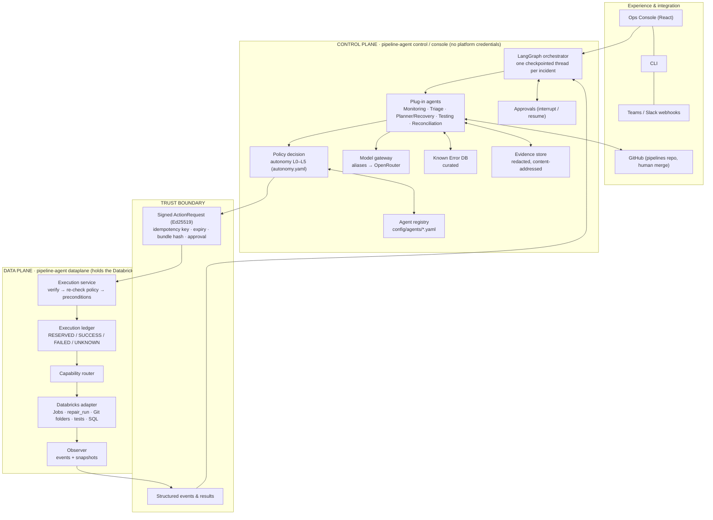

# 02 · Architecture

The agent follows the **Agentic AIOps for DataOps v2** reference architecture, scaled to the demo environment:

- a technology-agnostic **control plane** of LangGraph agents that reason, plan and *request* actions;
- a **trust boundary** that only signed, policy-checked ActionRequests cross;
- a technology-specific **data plane** that holds the platform credentials, verifies every request and executes it.



## Processes

| Process | Command | Holds | Never holds |
|---|---|---|---|
| Data plane | `pipeline-agent dataplane` | Databricks token, the **public** signing key | LLM key, GitHub identity, private key |
| Control plane | `pipeline-agent control` | **Private** signing key, OpenRouter key, GitHub App (the agent's identity) | Platform credentials |
| Console | `pipeline-agent console` | Session secret; OpenRouter (re-diagnosis); GitHub App (PR diffs, read) | Platform credentials, signing keys |

All three share one database (SQLite locally, Postgres when hosted) and an evidence directory. Each process holds a **lease**, so only one data plane and one control plane are active at a time. Compose gives each process its own env file and key mounts; see [docker-compose.yml](../docker-compose.yml).

## Reference diagram → implementation

| Reference box | Implementation | Code |
|---|---|---|
| Agent orchestrator (LangGraph) | One `StateGraph` thread per work item, SQLite/Postgres checkpointer, `interrupt()` for approvals and async waits | [control_plane/orchestrator.py](../src/pipeline_agent/control_plane/orchestrator.py), [runner.py](../src/pipeline_agent/control_plane/runner.py) |
| Planner & reasoner | KEDB runbook first, else by failure class; proposes concrete steps, never executes | [agents/planner.py](../src/pipeline_agent/control_plane/agents/planner.py) |
| Agent & capability registry | Manifests (A2A-card shaped): capabilities an agent may request, model alias, risk class | [config/agents/](../config/agents), [registry.py](../src/pipeline_agent/control_plane/registry.py) |
| Policy decision & approvals | Autonomy matrix agent × capability × env × failure pattern → L0–L5; OPA-shaped decision; sha256 bundle | [config/policy/autonomy.yaml](../config/policy/autonomy.yaml), [autonomy/engine.py](../src/pipeline_agent/autonomy/engine.py), [approvals.py](../src/pipeline_agent/control_plane/approvals.py) |
| Model gateway (adopt, wrap thinly) | Agents ask for an alias (`triage`, `fix`, `test`); budgets, redaction, call ledger in `LLMGateway` | [llm/model_gateway.py](../src/pipeline_agent/llm/model_gateway.py), [llm/gateway.py](../src/pipeline_agent/llm/gateway.py) |
| Monitoring agent | Data-plane events → work items (deduplicated; agent-started runs never open a second incident) | [agents/monitoring.py](../src/pipeline_agent/control_plane/agents/monitoring.py) |
| Triage agent | KEDB match on redacted evidence; LLM only for unknown and code failures; budget stop escalates | [agents/triage.py](../src/pipeline_agent/control_plane/agents/triage.py), [llm/triage.py](../src/pipeline_agent/llm/triage.py) |
| Recovery agent | Runtime runbooks (rerun, repair, cancel+rerun) and the code fix (patch writer + guards) with promotion | [planner.py](../src/pipeline_agent/control_plane/agents/planner.py), [codefix.py](../src/pipeline_agent/control_plane/codefix.py), [fix/patch.py](../src/pipeline_agent/fix/patch.py) |
| *Testing agent* (added) | Writes Databricks test notebooks; they run in Databricks on the fix branch and gate every code fix | [agents/testing.py](../src/pipeline_agent/control_plane/agents/testing.py) |
| Reconciliation agent | Run outcomes plus read-only `data.profile` checks (rows, duplicate keys, nulls) | [agents/reconciliation.py](../src/pipeline_agent/control_plane/agents/reconciliation.py) |
| PostgreSQL | One schema for both planes (work items, checkpoints, approvals, audit, KEDB, ledger, …) | [store/db.py](../src/pipeline_agent/store/db.py) |
| Known Error DB (structured) | Seeded from knowledge packs; agents only *propose*; an admin approves | [kedb.py](../src/pipeline_agent/kedb.py) |
| Evidence store + untrusted-evidence rule | Redacted, sha256-addressed blobs; integrity-checked; reaches a model only as `<untrusted_evidence>` | [evidence.py](../src/pipeline_agent/evidence.py) |
| Valkey / Redis (locks) | `leases` table (leader lease per process) | [leases.py](../src/pipeline_agent/leases.py) |
| Event bus | `events` outbox table, polled | [boundary/events.py](../src/pipeline_agent/boundary/events.py) |
| Tool gateway | Internal read-only tools (evidence, repo files, KEDB); no execute tool: agents emit ActionRequests | agents above |
| Trust boundary | Ed25519-signed ActionRequests in a pull queue; events and results flow back | [boundary/](../src/pipeline_agent/boundary), [security/signing.py](../src/pipeline_agent/security/signing.py) |
| Execution service | Verify signature and expiry → bundle hash = ours → policy re-evaluated → live preconditions → ledger → execute → post-conditions → evidence | [data_plane/executor.py](../src/pipeline_agent/data_plane/executor.py) |
| Execution ledger | One row per idempotency key; a replay returns the recorded outcome; a crash mid-call becomes UNKNOWN (never auto-retried) | [data_plane/ledger.py](../src/pipeline_agent/data_plane/ledger.py) |
| Capability router & registry | Stable capability ids → plugin adapters, with preconditions and post-conditions | [boundary/capabilities.py](../src/pipeline_agent/boundary/capabilities.py), [data_plane/router.py](../src/pipeline_agent/data_plane/router.py) |
| Azure Databricks adapter | Jobs API 2.2, `repair_run`, Git-folder sync (Repos API), `jobs.submit` + `git_source` tests, SQL profiles | [plugins/agent-plugin-databricks](../plugins/agent-plugin-databricks) |
| Identity & secrets broker | `env://` secret references; per-process env files; workload identity is pilot work | [secrets.py](../src/pipeline_agent/secrets.py) |
| **Not built (by choice)** | Read-only diagnostic MCP servers (the observer already pushes the evidence), pgvector, graph store, Kafka, OPA (the evaluator is OPA-shaped), Langfuse/OpenTelemetry | [07](07-future-improvements.md) |

## The incident graph

```
intake → triage → plan ─┬─(steps)→ decide ─┬─ L4/L5 → submit → wait_result ─┬─ watch → wait_run ─┐
                        │                  ├─ L3   → request_approval → wait_approval → decide    │
                        │                  └─ L0–L2 → close (escalate / recommend)                 │
                        ├─(code fix)→ fix_write → fix_tests → [tests.run] ─fail→ fix_repair ↺      │
                        │             fix_next → fix_open_pr → fix_wait_checks → fix_merge ─→ fix_deploy
                        │                                    → fix_wait_merge (prod: human) ─→ fix_deploy
                        └─(none)→ close                                  advance → decide | fix_next | reconcile → close
```

**Replay safety.** A resumed node runs again from its start, so:
- the `wait_*` nodes only call `interrupt()` and record what came back;
- every side effect (incident row, approval row, signed request, GitHub commit or PR) sits in its own node before a wait;
- each side effect is idempotent: one incident per run, one approval per (thread, capability), request keys of the form `wi-<id>:<results so far>:<capability>`, and an existing open PR is reused.

**Resuming.** The runner resumes a waiting thread when:
- an approval is decided;
- an action result arrives;
- a `run_finished` event comes in;
- a PR's checks finish;
- a prod PR is merged or closed;
- a wait times out (approval 24h; action and run 2h; PR merge `fix.max_wait_hours`), which escalates the incident.

## Runbooks and autonomy (default policy)

| Situation | Plan | Level | Who approves |
|---|---|---|---|
| Transient failure, prod | rerun (watched) + reconciliation checks | L4 | pre-approved, within rerun caps |
| Transient failure, dev/qa | rerun | L2 | recommend only; a human acts |
| Run over its threshold | cancel + rerun | L3 | one console approval covers both steps |
| Code failure, `auto_fix` | fix → Databricks tests → dev → qa → prod | L4 dev/qa merge, sync, smoke; L3 prod | prod: your **GitHub merge** approves the prod sync and the repair of the failed run |
| Code failure, no `auto_fix` | parked as "needs a code fix" | – | an approver clicks **Start fix** |
| Infra / permission / unknown | escalate (evidence only) | L1 | a human |
| Console cancel / rerun | one step | L3 | the requester's console session |
| Read-only (`data.profile`, `get_run`) | – | L5 | – |
| Kill switch on | nothing | L0 | – |

Rerun caps (per pipeline per 24h, from `pipelines.yaml`) and the circuit breaker (actions per hour) are counted from the execution ledger. Both planes evaluate the same policy bundle. The data plane refuses a request decided under a different bundle hash.

## Code-fix path (gated by the Testing agent)

1. **Recovery** writes the smallest notebook change on `fix/incident-<id>`, guarded:
   - allowed paths only;
   - must compile and pass pyflakes;
   - `DQAssertionError` checks kept;
   - forbidden runtime patterns rejected;
   - no secret-like strings.
2. The **Testing agent** writes test notebooks in `tests/`, guarded:
   - isolated `test_<id>_*` schemas;
   - runs `../notebooks/<name>` via `dbutils.notebook.run`;
   - drops its schemas afterwards.
3. `tests.run` runs them **in Databricks from the fix branch** (`jobs.submit` + `git_source`). A failure, or failing CI on the PR, sends the output back to Recovery (at most `repair_attempts`).
4. **dev, then qa:**
   - open a PR and wait for the checks;
   - merge (`code.merge`, L4);
   - `code.sync` pulls the environment's Git folder to the merge commit;
   - smoke-run that environment's job.
5. **prod:** the PR into `main` waits for a **human merge**. That merge is the approval for the prod `code.sync` and for `pipeline.repair` (re-run only the failed tasks of the original run).
6. Reconciliation, then resolved. A KEDB entry is proposed for an admin to approve.

## Data model ([store/db.py](../src/pipeline_agent/store/db.py))

| Table | Purpose |
|---|---|
| `runs`, `watermarks`, `platform_snapshots` | What the observer saw (runs; per-platform pipelines, active runs, health and costs for the console) |
| `events`, `work_items` | Data-plane events → control-plane work items (graph threads) |
| `action_requests`, `action_results`, `execution_ledger` | The trust boundary and exactly-once execution |
| `approvals` | L3 decisions that resume a graph |
| `incidents`, `fix_attempts`, `actions` | Projections for the console (incident lifecycle, fix promotion, runtime actions) |
| `known_errors`, `evidence` | Knowledge and evidence metadata (blobs live in `var/evidence/`) |
| `llm_calls` | LLM ledger: the source of truth for budgets |
| `audit_log` | Append-only record of every agent and human action |
| `agent_controls`, `leases` | Kill switch and dry run; heartbeats; leader leases |

LangGraph checkpoints live next to these: in `var/checkpoints.sqlite`, or in Postgres via `AGENT_CHECKPOINT_URL`.

## Security properties

- **Agents never execute anything.** The only path to a platform change is a request that is signed, checked against policy (twice), checked against live preconditions, and recorded once in the ledger.
- **Secrets stay with their owner.** Platform credentials exist only in the data plane. Logs, errors, evidence, notifications, the audit log and every LLM prompt are redacted. Evidence is untrusted data, framed as such.
- **Approvals are explicit.** L3 actions need a console approver. Prod code needs the GitHub merge (branch protection plus Code Owners). An approval kind a rule doesn't accept escalates instead of looping.
- **Tampering is detected.** A changed request fails signature verification. A changed policy fails the bundle-hash check. A changed evidence blob fails its sha256 check.

More detail: [11 · Security](11-security.md).
